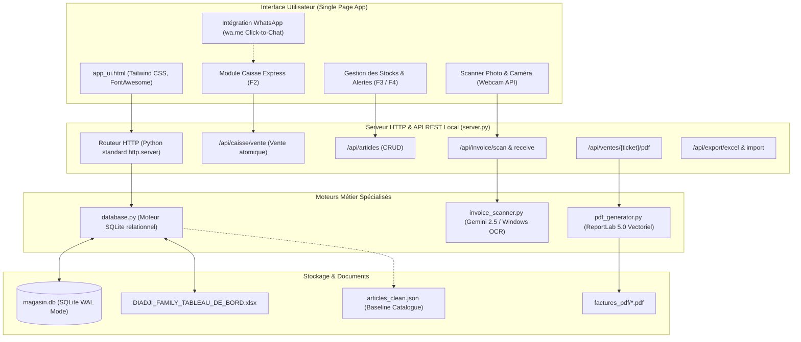

<p align="center">
  
</p>

<h1 align="center">🏪 DIADJI FAMILY</h1>

<p align="center">
  <strong>Logiciel de Caisse Express, Gestion des Stocks, Facturation PDF et Scanner IA Vision</strong><br>
  <em>Solution tout-en-un 100% embarquée, autonome et prête pour le commerce physique.</em>
</p>

<p align="center">
  <a href="#-fonctionnalités-clés"></a>
  <a href="#-architecture-technique"></a>
  <a href="#-base-de-données-embarquée-sqlite"></a>
  <a href="#-démarrage-rapide"></a>
  <a href="#-envoi-direct-sur-whatsapp"></a>
  <a href="#-tests-automatisés"></a>
  <a href="LICENSE"></a>
</p>

---

## 📑 Table des Matières

1. [🌟 Points Forts & Valeur Ajoutée](#-points-forts--valeur-ajoutée)
2. [⚡ Démarrage Rapide (1 Clic)](#-démarrage-rapide-1-clic)
3. [✨ Fonctionnalités Clés](#-fonctionnalités-clés)
   - [🛒 Caisse Express & Point de Vente Tactile](#-caisse-express--point-de-vente-tactile)
   - [💬 Envoi Direct sur WhatsApp](#-envoi-direct-sur-whatsapp)
   - [📄 Génération de Factures & Reçus PDF](#-génération-de-factures--reçus-pdf)
   - [📷 Scanner Intelligent de Factures (IA Vision & OCR)](#-scanner-intelligent-de-factures-ia-vision--ocr)
   - [📦 Gestion des Stocks, Alertes & Audit Trail](#-gestion-des-stocks-alertes--audit-trail)
   - [📊 Synchronisation avec Microsoft Excel](#-synchronisation-avec-microsoft-excel)
4. [🛡️ Compatibilité Windows 11 (Smart App Control)](#-compatibilité-windows-11-smart-app-control)
5. [🏗️ Architecture Technique](#-architecture-technique)
6. [📂 Structure Détaillée du Projet](#-structure-détaillée-du-projet)
7. [🧪 Tests Automatisés & Validation Continue](#-tests-automatisés--validation-continue)
8. [💻 Guide Développeur & Installation Source](#-guide-développeur--installation-source)
9. [📄 Licence](#-licence)

---

## 🌟 Points Forts & Valeur Ajoutée

* **100% Embarqué & Zéro Maintenance :** Fonctionne avec un moteur de données SQLite relationnel local (`magasin.db`). Aucun serveur externe (MySQL, PostgreSQL ou Docker) n'est nécessaire.
* **Batteries Included :** Livré avec le catalogue officiel complet de **183 articles de quincaillerie** et les prix réels extraits du document d'origine.
* **Interface Responsive Haute Performance :** Conçue sur-mesure pour ordinateurs de bureau, écrans tactiles, tablettes et téléphones portables.
* **Zéro Frais d'Abonnement :** Pas de frais mensuels pour WhatsApp ou la génération PDF : tout fonctionne directement via des protocoles web ouverts et du traitement local.
* **Continuité d'Activité Hors Ligne :** Même sans connexion Internet, la caisse, les stocks, l'impression papier, l'export Excel et l'OCR Windows natif fonctionnent à 100%.

---

## ⚡ Démarrage Rapide (1 Clic)

Sous Windows, vous disposez de 3 options pour lancer l'application immédiatement :

| Méthode | Comment faire ? | Comportement |
|---|---|---|
| **Raccourci Bureau** *(Recommandé)* | Double-cliquez sur l'icône **`DIADJI FAMILY`** sur votre Bureau Windows | Démarre instantanément en fenêtre dédiée (mode application sans barre d'adresse navigateur ni console noire). |
| **Lanceur Silencieux** | Double-cliquez sur [`LANCER_DIADJI_FAMILY.vbs`](file:///c:/Users/dell/Desktop/diadji/LANCER_DIADJI_FAMILY.vbs) | Lancement furtif et rapide sans aucune fenêtre noire CMD. |
| **Lanceur Console** | Double-cliquez sur [`LANCER_APPLICATION.bat`](file:///c:/Users/dell/Desktop/diadji/LANCER_APPLICATION.bat) | Lanceur classique avec vérification des dépendances et messages de diagnostic. |
| **Exécutable Autonome** | Double-cliquez sur `DIADJI_FAMILY.exe` | Exécutable Windows autonome avec Python et bibliothèques compilés. |

> [!TIP]
> **Créer les raccourcis en 1 clic :** Double-cliquez sur [`CREER_RACCOURCI_BUREAU.bat`](file:///c:/Users/dell/Desktop/diadji/CREER_RACCOURCI_BUREAU.bat) pour placer instantanément le logo officiel DIADJI FAMILY sur votre Bureau et dans le Menu Démarrer.

---

## ✨ Fonctionnalités Clés

### 🛒 Caisse Express & Point de Vente Tactile
* **Raccourci clavier `F2`** : Ouvre instantanément l'écran de caisse express depuis n'importe quel onglet.
* **Recherche Intelligente Instantanée** : Filtre en temps réel insensible à la casse et aux accents (*ex : tapez `cable`, `raccord` ou `interrupteur`*).
* **Modes de Règlement Variés** : Prise en charge des **Espèces**, **Wave**, **Orange Money**, Chèques et Virements.
* **Calcul Automatique** : Gestion des remises commerciales, calcul instantané de la monnaie à rendre et boutons de billets rapides (*Exact, 1 000, 2 000, 5 000, 10 000, 20 000 FCFA*).
* **Expérience Mobile Native & PWA (iOS / Android)** :
  * Barre de navigation mobile inférieure (*Bottom Navigation Bar*) avec badge panier temps réel.
  * Bouton central d'action surélevé (*FAB*) pour le scanner photo et caméra.
  * Tiroir tactile déroulant (*Bottom Sheet Drawer*) pour le menu complet, les actions et les KPIs.
  * Barres et boutons à haute réactivité tactile avec retour haptique vibrant (`triggerHaptic`).
  * Mode PWA autonome sans barre d'adresse (`manifest.json` intégré, installable sur écran d'accueil).
  * Barre de panier flottante ergonomique pour basculer entre catalogue et encaissement en 1 clic.

---

### 💬 Envoi Direct sur WhatsApp
* **Bouton Caisse `[ 💬 Encaisser & Envoyer sur WhatsApp ]`** :
  * Enregistre la vente en base SQLite.
  * Déduit les stocks de manière atomique.
  * Ouvre directement la conversation WhatsApp du client avec le ticket entièrement formaté, prêt à l'envoi.
* **Formatage Typographique Optimisé** : Ticket structuré avec séparateurs clairs, montants en FCFA, détail par article, remise accordée et mentions légales, sans aucun caractère corrompu.
* **Réexpédition Historique** : Renvoyez n'importe quelle facture passée en 1 clic depuis l'onglet « Historique & Ventes ».

---

### 📄 Génération de Factures & Reçus PDF
* **Moteur Vectoriel Haute Résolution (`pdf_generator.py`)** basé sur ReportLab :
  * En-tête aux couleurs de la marque (*Bleu marine `#0F172A` & Vert émeraude `#0D9488`*).
  * Coordonnées du magasin, N° de facture unique (`TK-AAAAMMJJ-XXXX`) et horodatage précis.
  * Tableau comptable avec Réf, Désignation, Quantité avec unités (*Pièce, Rouleau, Sac...*), Prix Unitaire et Total.
  * Bloc récapitulatif financier et zone réservée pour le Cachet & Visa de la caisse.
* **Téléchargement & Affichage Instantanés** : Accessible via le bouton rouge **`[ 📄 Facture PDF ]`** du ticket ou directement depuis l'historique des ventes.

---

### 📷 Scanner Intelligent de Factures (IA Vision & OCR)
* **Traitement des Factures de Livraison Manuscrites ou Froissées** :
  * Importation de photos ou scans de bons de livraison fournisseurs (`.jpg`, `.png`, `.webp`).
  * Détection automatique de la webcam PC ou de la caméra smartphone avec sélection de l'appareil.
* **Double Moteur Hybride** :
  1. **IA Multimodale Google Gemini Vision** : Analyse sémantique poussée des écritures manuscrites difficiles et des tableaux complexes.
  2. **OCR Local Windows Media (100% Hors Ligne)** : Bascule automatique si aucune clé API n'est configurée ou en cas de coupure Internet.
* **Correspondance Intelligente (*Fuzzy Matching*)** : Rapprochement automatique des libellés manuscrits avec les articles existants du catalogue.
* **Auto-Génération des Codes Articles** : Les articles inédits se voient attribuer automatiquement des codes séquentiels propres (`ART-184`, `ART-185`...).
* **Mise en Stock en 1 Clic** : Validation du lot avec mise à jour immédiate des stocks et traçabilité fournisseur.

---

### 📦 Gestion des Stocks, Alertes & Audit Trail
* **Raccourcis `F3` (Catalogue) & `F4` (Nouvel Article)**.
* **Fiches Articles Exhaustives** : Code, Rayon/Catégorie, Désignation, Unité, Prix de Vente, Stock Actuel, Seuil d'Alerte Minimum, Stock en Commande, Fournisseur et Emplacement physique.
* **Journal des Mouvements Inaltérable** : Traçabilité absolue de chaque flux (`VENTE`, `ENTREE`, `AJUSTEMENT`, `RETOUR`, `COMMANDE_FOURNISSEUR`).
* **Tableau de Bord des Ruptures** : Détection automatique des stocks faibles avec calcul du besoin net de réapprovisionnement et estimation budgétaire.

---

### 📊 Synchronisation avec Microsoft Excel
* **Exportation Automatique** vers [`DIADJI_FAMILY_TABLEAU_DE_BORD.xlsx`](file:///c:/Users/dell/Desktop/diadji/DIADJI_FAMILY_TABLEAU_DE_BORD.xlsx) :
  * Feuille d'inventaire avec mise en forme conditionnelle et formules de valorisation du stock.
  * Feuille historique des encaissements et ventes récentes.
* **Importation / Synchronisation Bidirectionnelle** : Modifiez vos prix ou stocks dans Excel et réimportez le fichier pour actualiser instantanément la base SQLite.

---

## 🛡️ Compatibilité Windows 11 (Smart App Control)

Sous Windows 11, la fonctionnalité **Contrôle intelligent des applications (Smart App Control - SAC)** peut bloquer les exécutables `.exe` compilés localement qui ne possèdent pas de certificat commercial payant.

Pour garantir une expérience fluide à 100% :
1. Nos lanceurs prioritaires ([`LANCER_DIADJI_FAMILY.vbs`](file:///c:/Users/dell/Desktop/diadji/LANCER_DIADJI_FAMILY.vbs) et le raccourci Bureau) s'appuient sur l'interpréteur officiel signé numériquement par la **Python Software Foundation** et **Microsoft Corporation** (`CN=Microsoft ID Verified CS EOC CA 04`).
2. Grâce à cette signature officielle de confiance maximale, **Windows 11 exécute l'application instantanément sans afficher aucun avertissement de sécurité**.

---

## 🏗️ Architecture Technique



---

## 📂 Structure Détaillée du Projet

```text
c:\Users\dell\Desktop\diadji\
├── app.py                                   # Point d'entrée principal (démarre le serveur et ouvre la fenêtre)
├── server.py                                # Serveur HTTP local & API REST JSON
├── database.py                              # Couche d'accès aux données SQLite, intégrité & synchro Excel
├── pdf_generator.py                         # Moteur de génération des Factures & Reçus de caisse PDF
├── invoice_scanner.py                       # Scanner IA Vision & OCR pour bons de livraison
├── app_ui.html                              # Interface utilisateur unique réactive (HTML5 / Tailwind CSS)
├── gui_desktop.py                           # Interface de secours bureautique native (Tkinter)
│
├── magasin.db                               # Base de données SQLite locale relationnelle (183 articles prêts)
├── articles_clean.json                      # Sauvegarde du catalogue de référence (données sources)
├── DIADJI_FAMILY_TABLEAU_DE_BORD.xlsx       # Classeur Excel maître officiel synchronisé
├── diadji_icon.ico / diadji_icon.png        # Icônes officielles de la marque DIADJI FAMILY
├── QUINCAILLERIE DIADJI GNINGUE.pdf         # Document PDF d'origine du catalogue
│
├── LANCER_DIADJI_FAMILY.vbs                 # Lanceur silencieux sans console noire (Windows 11)
├── LANCER_APPLICATION.bat                   # Lanceur standard via invite de commandes
├── CREER_RACCOURCI_BUREAU.bat               # Script batch de création des raccourcis Windows
├── create_shortcuts.ps1                     # Script PowerShell d'intégration Bureau & Menu Démarrer
├── LANCER_TESTS.bat                         # Lanceur rapide de la suite de 54 tests
├── DESINSTALLER_DIADJI_FAMILY.bat           # Script de suppression des raccourcis
│
├── factures_pdf/                            # Dossier d'archivage des factures PDF éditées
├── tests/                                   # Suite complète de tests unitaires et d'intégration
│   ├── run_tests.py                         # Lanceur unifié Python (découverte automatique)
│   ├── test_software_comprehensive.py       # Validation complète du serveur, du CRUD et de la caisse
│   ├── test_invoice_pdf.py                  # Validation de la génération et du téléchargement PDF
│   ├── test_invoice_scan_and_reception.py   # Validation de l'OCR et du scanner IA
│   ├── test_auto_code_and_camera.py         # Validation de la caméra et de l'auto-génération des codes
│   ├── test_responsive_ui.py                # Validation du design responsive mobile/tablette/PC
│   ├── test_whatsapp_feature.py             # Validation du formatage WhatsApp et de l'assainissement tél
│   └── test_custom_dialog_integration.py    # Validation des modales personnalisées
│
├── vendor/                                  # Dépendances locales embarquées
│   ├── wheels/                              # Packages Python hors-ligne (openpyxl, et_xmlfile)
│   └── TELECHARGER_PYTHON_PORTABLE.bat      # Script d'approvisionnement du runtime portable
│
├── requirements.txt                         # Dépendances Python requises
├── LICENSE                                  # Licence MIT
└── README.md                                # Guide complet d'utilisation et d'architecture
```

---

## 🧪 Tests Automatisés & Validation Continue

Le projet intègre une suite rigoureuse de **55 tests automatisés** couvrant l'intégralité du cycle de vie de l'application :

```bash
# Pour exécuter la suite de tests avec rapport détaillé :
python tests/run_tests.py

# Ou sous Windows en 1 clic :
LANCER_TESTS.bat
```

### Résumé des Résultats :
* **55 tests exécutés avec succès (0 échec, 0 erreur)**.
* Temps d'exécution : ~14 secondes.
* Couverture : Base relationnelle, contraintes de clés étrangères, mode WAL, génération des numéros de ticket, gestion de la monnaie, flux de vente, génération PDF vectorielle, OCR, et tests d'intégration DOM.

---

## 💻 Guide Développeur & Installation Source

Si vous souhaitez contribuer ou exécuter le projet depuis les sources :

```bash
# 1. Cloner le dépôt Git
git clone https://github.com/votre-compte/diadji-family.git
cd diadji-family

# 2. Créer et activer un environnement virtuel (recommandé)
python -m venv venv
venv\Scripts\activate

# 3. Installer les dépendances
pip install -r requirements.txt

# 4. Lancer les tests pour valider l'environnement
python tests/run_tests.py

# 5. Démarrer l'application
python app.py
```

L'application démarre son serveur local sur `http://127.0.0.1:8000` et ouvre automatiquement la fenêtre dédiée dans votre navigateur.

---

## 📄 Licence

Ce projet est distribué sous **Licence MIT**. Consultez le fichier [`LICENSE`](LICENSE) pour plus de détails.

---

<p align="center">
  <strong>DIADJI FAMILY</strong> • <em>Dakar, Sénégal</em><br>
  <em>Commerce Général • Matériaux de Construction • Électricité • Outillage</em>
</p>
